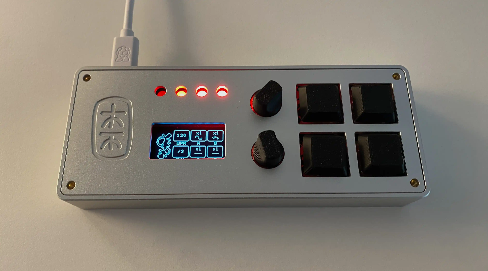

# Clocked Modulator



four lfos, one clock.  
a small usb box for tempo-synced modulation. each output has its own waveform, cycle length and range. set the tempo by encoder or tap. sends 14-bit midi cc to touchdesigner or any midi host, no driver needed.  
built on raspberry pi pico 2. written in rust.

**[Manual and build guide](https://matthiasmeissen.github.io/clocked-modulator/)**

## What is in this repo

- [Firmware](firmware/) Rust firmware (Cargo project)
- [Hardware](hardware/) PCB source files and fabrication outputs
- [Enclosure](enclosure/) Printable and editable enclosure files
- [Docs](docs/) The manual (also the website) and design notes

## Install the firmware

Without Rust: download `clocked-modulator.uf2` from the
[latest release](https://github.com/matthiasmeissen/clocked-modulator/releases/latest),
hold BOOTSEL while plugging in the Pico 2, and drag the file onto the `RP2350` drive.

From source, with a debug probe connected:

```sh
cd firmware
cargo run --release
```

The [manual](https://matthiasmeissen.github.io/clocked-modulator/) covers
wiring, assembly and how to use the device.

## License

The firmware is released under the [MIT License](firmware/LICENSE).

<!-- TODO: licence for hardware/, enclosure/ and docs/ is not chosen yet -->
The hardware, enclosure and documentation files do not have a license yet.
