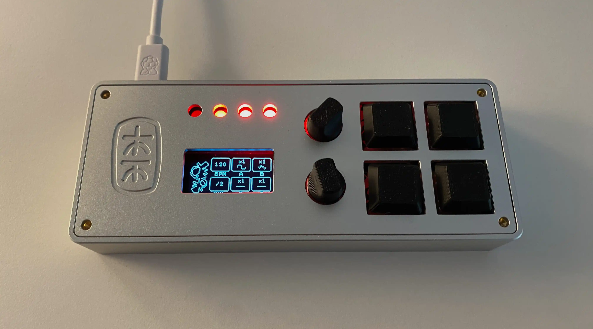

# Clocked Modulator

A small USB box that generates four tempo-synced LFOs and sends them to your
computer as MIDI. Source, PCB and enclosure files are on
[GitHub](https://github.com/matthiasmeissen/clocked-modulator).

<!-- TODO: short demo clip -->

- [Using it](#using-it)
- [MIDI output](#midi-output)
- [Building one](#building-one)

## Using it

The device has a display, two encoders (ENC1, ENC2), six buttons (B1 to B6) and
four LEDs that show the four outputs, called slots A, B, C and D. B1 and B4 are
the push switches of ENC1 and ENC2; the other four are the keys.

<!-- TODO: diagram is outdated (no Noise page, old Overview actions); redraw -->

### Overview

This is the page shown after power-on. The clock starts at 120 BPM.

| Control | Action |
| --- | --- |
| ENC1 | Tempo, 20 to 300 BPM |
| ENC2 | Global speed: /4, /2, x1, x2, x4 |
| B1 | Open the tempo page |
| B2, B3, B5, B6 | Edit slot A, B, C, D |
| B4 | Set global speed back to x1 |

### Tempo page

| Control | Action |
| --- | --- |
| ENC1 | Tempo, 20 to 300 BPM |
| B3 | Tap tempo. Tap at least four times, less than two seconds apart |
| B4 | Set tempo back to 120 BPM |
| B5 | Pause |
| B6 | Resume when paused, restart the bar when playing |
| B2 | Back to Overview |

### Editing a slot

Each slot has three pages. B6 moves to the next page (Wave, Range, Noise, then
Wave again) and B2 goes back to Overview.

**Wave**

| Control | Action |
| --- | --- |
| ENC1 | Waveform: SIN, TRI, SQU, SAW, CON (constant), NOI (noise) |
| ENC2 | Cycle length: /8, /4, /2 (8, 4, 2 bars), x1 (1 bar), x2 (2 beats), x4 (1 beat) |
| B3 | Set waveform and cycle length back to SAW and x1 |
| B5 | Apply. Changes on this page take effect only when you press B5 |

**Range**

| Control | Action |
| --- | --- |
| ENC1 | Minimum output value |
| ENC2 | Maximum output value |
| B3 | Set the range back to full |
| B5 | Smoothing on or off |

**Noise** (affects the NOI waveform only)

| Control | Action |
| --- | --- |
| ENC1 | Frequency, 1 to 16 humps per cycle |
| ENC2 | Seed, which selects a different noise pattern |
| B3 | Set frequency and seed back to their defaults |

Changes on the Range and Noise pages take effect immediately. The noise pattern
repeats exactly every cycle, so it stays in sync with the clock. Settings are
not saved; the device starts with its defaults each time it is powered on.

## MIDI output

The device appears as a USB MIDI device named "Clocked Modulator". No driver is
needed. Each slot is sent as a 14-bit control change on channel 1, about 125
times per second:

| Slot | MSB (coarse) | LSB (fine) |
| --- | --- | --- |
| A | CC 0 | CC 32 |
| B | CC 1 | CC 33 |
| C | CC 2 | CC 34 |
| D | CC 3 | CC 35 |

Hosts that only read 7-bit CCs can use CC 0 to 3 and ignore the rest. For the
full resolution, combine the pair as `(MSB * 128 + LSB) / 16383`.

## Building one

### Parts

- Bought parts: everything is in the [BOM](https://github.com/matthiasmeissen/clocked-modulator/blob/main/hardware/fab/bom.csv), with suppliers and links
- The PCB: order it with the [Gerber files](https://github.com/matthiasmeissen/clocked-modulator/blob/main/hardware/fab/gerbers.zip)
- Printed parts: the case, cover and encoder knobs in [enclosure/](https://github.com/matthiasmeissen/clocked-modulator/tree/main/enclosure)

The [schematic](https://github.com/matthiasmeissen/clocked-modulator/blob/main/hardware/fab/schematic.pdf) shows how everything connects.

### Assembly

<!-- TODO: assembly order, and the sizes of the inserts, spacers and screws -->

- Check the pin order of the display before soldering. It must be
  VCC-GND-SCL-SDA; modules with VCC and GND swapped exist and will not work.
- Install the firmware before closing the case. The BOOTSEL button cannot be
  reached once the Pico is inside.
- The case takes threaded inserts. The cover rests on 1 cm spacers and is
  screwed into the inserts.

### Firmware

Download `clocked-modulator.uf2` from the
[latest release](https://github.com/matthiasmeissen/clocked-modulator/releases/latest).
Do this before closing the case. Hold the BOOTSEL button on the Pico 2 while plugging it in, then drag the file
onto the `RP2350` drive that appears. The Pico restarts on its own.

To build from source instead, see the
[firmware folder](https://github.com/matthiasmeissen/clocked-modulator/tree/main/firmware).

### First power-on

The display shows the Overview page at 120 BPM, the LED for slot A fades up
once per bar, and the LEDs for slots B, C and D are fully lit. The computer
lists a MIDI device named "Clocked Modulator".

<!-- TODO: confirm the above against a freshly flashed device and add a photo -->
